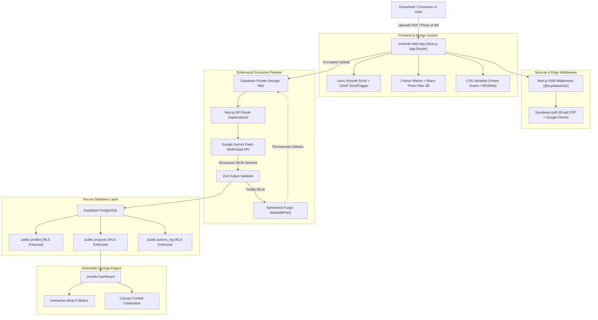

# ImVerde 🌱

> **Premium Clean Energy Intelligence for India**  
> Transform monthly electricity bills into deep carbon footprint insights and high-ROI monetary savings.

---

## 1. Overview

**ImVerde** is an Apple- and Nike-grade web application engineered to accelerate India's household decarbonization journey. By uploading an electricity bill from any regional state utility (such as BESCOM, TANGEDCO, MSEDCL, Tata Power, or BSES), users receive:
1. **Precise Carbon Footprint Auditing**: Calibrated against the Central Electricity Authority (CEA) national grid carbon baseline of **0.82 kg CO₂ / kWh**.
2. **Actionable Financial Savings**: High-ROI household steps (BLDC inverter conversions, optimum 24°C–26°C AC settings, rooftop solar net-metering) ranked by rupees saved per month (₹).
3. **Zero-Retention Ephemeral Privacy**: Uploaded bill documents are processed exclusively in private storage and purged immediately upon analysis completion.

---

## 2. Architecture Diagram



---

## 3. Technology Stack

- **Framework**: [Next.js](https://nextjs.org/) 14 (App Router, Server Components, Server Actions)
- **Language**: [TypeScript](https://www.typescriptlang.org/) (Strict typing)
- **Styling**: [Tailwind CSS](https://tailwindcss.com/) with custom tokens for Light & Dark mode
- **Backend & Database**: [Supabase](https://supabase.com/) (Auth, PostgreSQL, Private Storage, Row Level Security)
- **AI & Document Parsing**: [Google Gemini Flash](https://ai.google.dev/) multimodal model
- **Motion & 3D**:
  - [Lenis](https://lenis.darkroom.engineering/) (Smooth inertial scrolling)
  - [GSAP](https://gsap.com/) + ScrollTrigger (Scroll-linked scrub animations)
  - [Framer Motion](https://www.framer.com/motion/) (Page transitions & magnetic button physics)
  - [React Three Fiber](https://r3f.docs.pmnd.rs/) & [Three.js](https://threejs.org/) (Interactive 3D eco-canvas)
- **Validation**: [Zod](https://zod.dev/)

---

## 4. Local Setup & Quick Start

### Prerequisites
- Node.js `v18.18.0` or higher (Node `v24.x` supported)
- An active [Supabase project](https://database.new)
- A [Google Gemini API Key](https://aistudio.google.com/)

### Installation Steps

1. **Clone the repository**:
   ```bash
   git clone https://github.com/srivignesharya/imverde.git
   cd imverde
   ```

2. **Install dependencies**:
   ```bash
   npm install
   ```

3. **Configure environment variables**:
   Create a `.env.local` file modeled after `.env.example`:
   ```bash
   cp .env.example .env.local
   ```
   Fill in your credentials:
   ```env
   NEXT_PUBLIC_SUPABASE_URL=https://your-project.supabase.co
   NEXT_PUBLIC_SUPABASE_ANON_KEY=your-supabase-anon-key
   SUPABASE_SERVICE_ROLE_KEY=your-supabase-service-role-key
   GEMINI_API_KEY=your-gemini-api-key
   ```

4. **Run database migrations**:
   In your Supabase Dashboard, go to **SQL Editor** $\rightarrow$ **New Query**, paste the contents of [`supabase/migrations/20261103000001_initial_schema.sql`](file:///c:/Users/Sri%20Vignesh%20arya/Desktop/imverde/supabase/migrations/20261103000001_initial_schema.sql), and run it.

5. **Start development server**:
   ```bash
   npm run dev
   ```
   Visit `http://localhost:3000` or inspect components at `http://localhost:3000/design`.

---

## 5. Deployment Guide (Vercel)

1. **Push your code to GitHub**:
   ```bash
   git push origin main
   ```
2. **Import Project into Vercel**:
   - Navigate to [Vercel Dashboard](https://vercel.com/new).
   - Click **Import** next to your `imverde` repository.
   - Framework preset will automatically detect **Next.js**.
3. **Add Environment Variables**:
   Under **Environment Variables**, add the four required keys:
   - `NEXT_PUBLIC_SUPABASE_URL`
   - `NEXT_PUBLIC_SUPABASE_ANON_KEY`
   - `SUPABASE_SERVICE_ROLE_KEY`
   - `GEMINI_API_KEY`
4. **Deploy**:
   Click **Deploy**. Your site will build and be assigned a live production domain (e.g., `https://imverde.vercel.app`).
5. **Update Supabase Auth Redirect URLs**:
   In the [Supabase Dashboard](https://supabase.com/dashboard) under **Authentication** $\rightarrow$ **URL Configuration**:
   - Set **Site URL** to your Vercel URL: `https://imverde.vercel.app`
   - In **Redirect URLs**, add: `https://imverde.vercel.app/auth/callback`

---

## 6. Production Checklist

- [x] **Row Level Security (RLS)**: Enforced on all tables (`profiles`, `analyses`, `actions_log`) and storage objects (`bills` bucket). Verify via `SELECT * FROM pg_tables WHERE schemaname = 'public'`.
- [ ] **Rate Limiting on Gemini API Route**: Enforce token-bucket rate limiting (e.g. 10 requests per user/IP per hour using `@upstash/ratelimit` or Redis) on `/api/analyze` to prevent API exhaustion and abuse.
- [ ] **Error Monitoring & Telemetry**: Integrate Sentry (`@sentry/nextjs`) to capture client and server runtime errors without capturing sensitive utility bill payloads or PII.
- [x] **Ephemeral Document Deletion**: Verify files uploaded to `bills/${userId}/` are deleted immediately inside the `finally` block of the analysis route.
- [x] **Prefers-Reduced-Motion Support**: GPU animations gracefully fall back to zero duration or opacity-only transitions for accessibility.

---

## 7. Environmental & Financial Impact

- **India Grid Factor**: India's national grid emits an average of **0.82 kg CO₂ per kWh** (Source: Central Electricity Authority, Ministry of Power).
- **Scale of Opportunity**: A standard urban household consuming 350 kWh/month produces ~3.4 tonnes of CO₂ annually.
- **Projected Impact**:
  - Setting AC thermostats from 18°C to 24°C saves **~₹7,200** and **~780 kg CO₂** annually per home.
  - Converting 4 ceiling fans to BLDC 5-star motors saves **~₹5,000** and **~540 kg CO₂** annually.
  - 10,000 households taking 2 core actions abates over **13,000 metric tonnes of CO₂** each year while returning ₹12+ crore to Indian families.

---

## 8. License

Designed and built with pride for India's clean energy future. Distributed under the MIT License.
